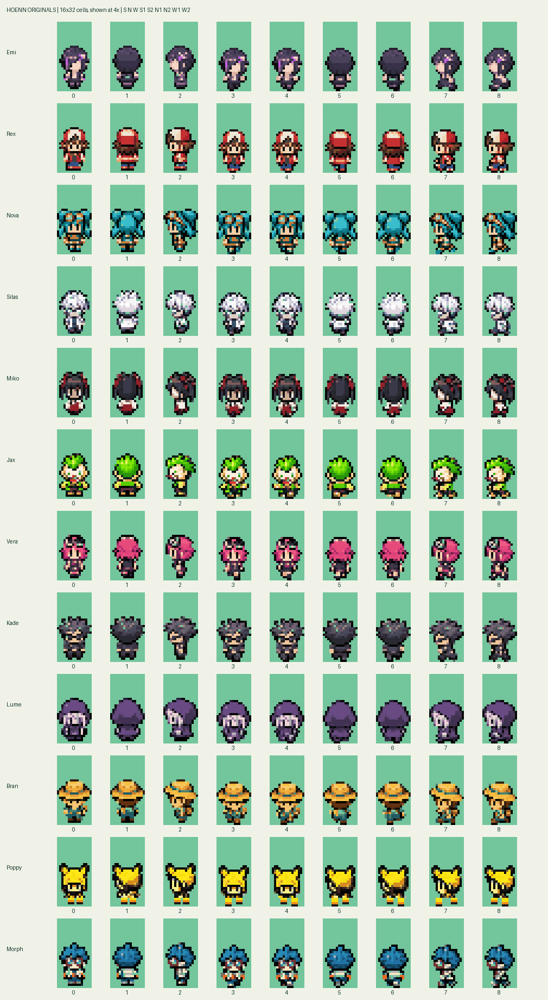
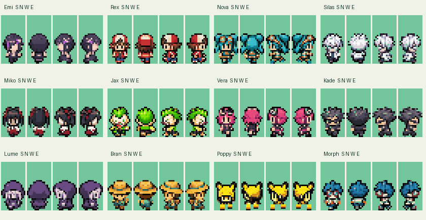

# Hoenn original NPC assets

Twelve new, independently indexed overworld sprite sheets based on the supplied
**Hoenn NPC Expansion Pack – Set 1** character reference. This is an asset-only
handoff for Codex integration. No original sprite, map, script, graphics ID,
palette tag, or existing project file has been replaced.





## Files

Each lowercase character name has:

- `graphics/object_events/pics/people/hoenn_originals/<name>.png`: **144×32,
  4-bit indexed PNG**, nine adjacent **16×32** frames. Index **0** is transparent;
  there are exactly **16 palette entries**, including that transparent index.
- `graphics/object_events/palettes/hoenn_originals/<name>.pal`: matching ordered
  16-entry JASC palette. RGB values are representable by GBA RGB555.
- `graphics/object_events/pics/people/hoenn_originals/<name>.json`: editable,
  authoritative palette and 32 rows of literal hexadecimal pixel indices.
- `docs/hoenn_originals/previews/<name>.gif`: four-direction walking preview.

| Name | Recognizable design | Preview |
| --- | --- | --- |
| Emi | Asymmetric dark fringe, violet streak/clip, purple sleeves and dark skirt | [Walk](previews/emi.gif) |
| Rex | Red/cream cap, brown hair, red jacket, blue shorts | [Walk](previews/rex.gif) |
| Nova | Cyan twin buns/locks, orange goggles and utility accents | [Walk](previews/nova.gif) |
| Silas | Spiky white hair, glasses, white alchemist coat | [Walk](previews/silas.gif) |
| Miko | Black twin tails, red ribbons, white sleeves and red skirt | [Walk](previews/miko.gif) |
| Jax | Lime mohawk, comic red nose/grin, yellow and green clothing | [Walk](previews/jax.gif) |
| Vera | Magenta bob, goggles, dark outfit and purple belt | [Walk](previews/vera.gif) |
| Kade | Charcoal spikes, sunglasses, dark biker jacket | [Walk](previews/kade.gif) |
| Lume | Purple hood, lilac side locks, dark cloak | [Walk](previews/lume.gif) |
| Bran | Wide straw hat, teal band, blue/teal fishing clothes and tan pack | [Walk](previews/bran.gif) |
| Poppy | Yellow mouse hood with dark ear tips, dark fringe, orange shoes | [Walk](previews/poppy.gif) |
| Morph | Blue spikes, large red glasses, green jacket and orange tie | [Walk](previews/morph.gif) |

Poppy is the canonical spelling requested by the user; the reference poster's
"Poypy" label is not used in filenames or code.

## Frame contract

This order matches `sAnimTable_Standard` in
`src/data/object_events/object_event_anims.h`, not the poster's grouped rows.
Coordinates are zero-based, and each interval below is inclusive.

| Index | Sheet x | Direction and pose |
| --- | --- | --- |
| 0 | 0–15 | South standing |
| 1 | 16–31 | North standing |
| 2 | 32–47 | West standing |
| 3 | 48–63 | South step A |
| 4 | 64–79 | South step B |
| 5 | 80–95 | North step A |
| 6 | 96–111 | North step B |
| 7 | 112–127 | West step A |
| 8 | 128–143 | West step B |

South cycle: **3, 0, 4, 0**. North: **5, 1, 6, 1**. West: **7, 2, 8, 2**.
East uses **7, 2, 8, 2 with horizontal flip**. Normal walk frames last eight
game ticks each. The GIFs approximate this with 130 ms steps (GIF timing is
quantized); they are visual previews, not an emulator capture.

Like the inspected Emerald templates, standing feet end at **y=30**, and step
feet end at **y=31**. Standing adult silhouettes begin at y=11; walking heads
are translated down exactly one pixel. Poppy begins one pixel lower. Every
frame retains the full 16×32 cell; no cropped frame is passed to the engine.
Hair and face pixels are locked between each direction's idle and step views.

Native proportion/animation references inspected at base commit
`6f59e663c2174dce5b0cf62ed668a69a40b87bf3`:
`woman_1.png`, `girl_1.png`, `man_1.png`, `fisherman.png`, `hex_maniac.png`,
and `scientist_1.png`, under `graphics/object_events/pics/people/`.
The new art uses their cell envelope, vertical offsets and animation order.
It is not a byte-for-byte reskin of their animation pixels.

Nine frames imply mirrored east-facing details. Emi's fringe/clip and other
asymmetric accessories therefore change sides when facing east, just as they
do in ordinary nine-frame Emerald graphics. Separate east art would require
more frames and a different animation table.

## Rebuild and validate

With Python 3 and Pillow installed, from the repository root:

```sh
python tools/hoenn_originals.py build
python tools/hoenn_originals.py check
```

Edit the JSON pixel rows/palette to revise art, then rebuild. The final build
does not need an image-generation service, API key, NumPy or SciPy. `check`
compares the PNG pixels and palette to the source and writes
[`validation.json`](validation.json), including PNG SHA-256 hashes, per-frame
bounds and visible color counts.

Validated locally:

- Twelve 144×32 PNGs with physical 4-bit indexed PNG headers and 16-entry PLTEs.
- Index 0 transparency, no partial-alpha pixels and indices limited to 0–15.
- Exact ordered agreement between each PNG, JASC palette and JSON source.
- RGB555-representable palette channels.
- Nine nonempty distinct poses per sheet; no head registration drift.
- Standing/step foot anchors and visual inspection of all 108 frames.
- Independent Python GBA 4bpp encoding/decoding round trip: **2,304 bytes per
  nine-frame sheet**, ordered as nine 2×4-tile metatiles.
- All four preview directions, including runtime-style east mirroring.

**Not tested:** the repository's actual `gbagfx` executable, ROM compilation,
object-event registration, runtime palette allocation, simultaneous NPC palette
loads, map placement, movement scripts, reflections, shadows or emulator play.
No GBA toolchain is configured in the authoring environment. The Python tile
round trip is a format check, not a claim that the repository converter ran.

## Integration handoff

Keep this PR draft until the integrating Codex task has completed these steps:

1. Allocate unused graphics IDs and unique palette tags against the current
   project state. Each character has its own 16-entry palette; do not substitute
   a shared vanilla NPC palette or assume all twelve palettes fit concurrently.
2. Add graphics declarations using the normal conversion parameters, e.g.:

   ```c
   const u32 gObjectEventPic_Emi[] = INCGFX_U32("graphics/object_events/pics/people/hoenn_originals/emi.png", ".4bpp", "-mwidth 2 -mheight 4");
   ```

3. Add the palette declarations and palette-table entries using the new tags.
   Build each `.pal` through the repository's usual `.gbapal` conversion.
4. Add ascending 2×4-tile frame tables and new `ObjectEventGraphicsInfo` entries
   based on an existing 16×32 NPC. Use `sAnimTable_Standard` and the corresponding
   16×32 OAM/subsprite tables. Add the graphics-info pointers and constants.
5. Choose a reflection policy for each new palette; no special reflection
   palettes are included. Check the repository's palette-slot rules before
   selecting slots. Place test NPCs on a temporary test map without changing
   existing residents or story maps.
6. Run actual PNG-to-4bpp and palette conversion, compile the ROM, and verify all
   four facing directions, normal/fast movement, turns, stopping, foot position,
   camera scrolling, palette coexistence, water reflections and ground shadows
   in an emulator. Check silhouettes against adjacent native NPCs.

See [art provenance and prompts](ART_NOTES.md) for the source workflow. These
are game-format asset candidates ready for integration review; in-game behavior
remains unverified.
